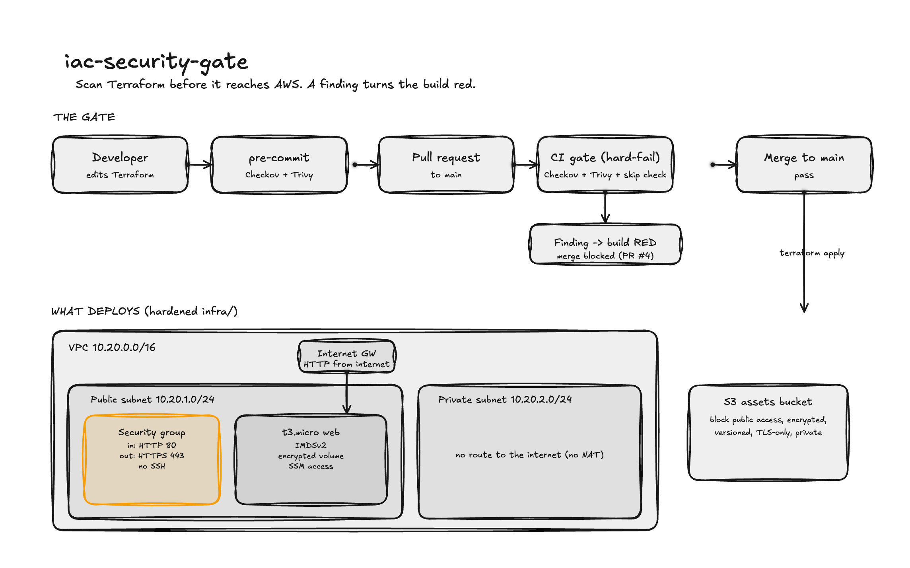

# iac-security-gate

Catch insecure Terraform before it reaches AWS. This repo is an **enforcement
point**: two scanners (Checkov and Trivy) run on every commit and every pull
request, and a finding turns the build red. A pull request that opens SSH to
the world or makes an S3 bucket public is blocked; the fixed version passes.



## What this is

A small VPC and web app written in Terraform (`infra/`), wrapped in a gate that
runs the same checks in three places:

- **pre-commit** — Checkov and Trivy run before a commit is made, so a developer
  sees the problem on their own machine.
- **CI** (`.github/workflows/iac-gate.yml`) — the gate of record. It runs on
  every pull request and every push to `main`, and **hard-fails** on any
  finding. No soft-fail, no `|| true`, no `continue-on-error`.
- **`make scan`** — the same scan, on demand.

The app itself is deliberately minimal: a VPC with a public and a private
subnet, an internet gateway, no NAT gateway; one `t3.micro` web server in the
public subnet serving a one-line page over HTTP (no SSH — access is via SSM
Session Manager); and one private S3 bucket for assets. It exists so the gate
has something real to protect.

`examples/insecure/` is the same app built wrong. It is **never deployed**;
`make scan-insecure` scans it to prove the scanners can turn red.

## The result: a vulnerable PR is blocked, the fixed one passes

| Pull request | Change | CI | |
|---|---|---|---|
| [#1](https://github.com/Keniolax/iac-security-gate/pull/1) | web server + bucket, **insecure** | 🔴 [failed](https://github.com/Keniolax/iac-security-gate/actions/runs/42086911991) | not merged, left closed as evidence |
| [#2](https://github.com/Keniolax/iac-security-gate/pull/2) | web server + bucket, **hardened** | 🟢 [passed](https://github.com/Keniolax/iac-security-gate/actions/runs/42087006460) | merged |

PR #1 failed at the Checkov step with 21 findings named (SSH open, public
bucket, IMDSv1, unencrypted volume). It was also refused locally by pre-commit
before it could be pushed. See [`evidence/`](evidence/).

## Quickstart

**Prerequisites** (pinned; see [versions](#pinned-versions)):
Terraform 1.14.1, Python 3.10+, Checkov 3.3.30, Trivy 0.76.1. Linux/amd64 is
the tested target (CI runs on `ubuntu-latest`).

```bash
# install the scanners
pip install checkov==3.3.30
./scripts/install-trivy.sh ~/.local/bin        # pinned binary, verified by sha256

# run the gate on the real app (passes)
make scan

# run it on the broken twin (fails on purpose, prints the findings)
make scan-insecure

# install the gate as a git hook so it runs before every commit
make precommit-install        # needs: pip install pre-commit

# deploy / tear down the hardened app (needs AWS credentials)
make deploy
make destroy
```

`make scan` prints `0` findings and exits 0. `make scan-insecure` prints the
findings and exits non-zero — that is the point.

## What each break is, and which scanner catches it

The five deliberate breaks in `examples/insecure/`, each mapped to the Checkov
and Trivy checks that catch it and to the CIS AWS Foundations Benchmark v3.0.0
control it violates:

| Break | Checkov | Trivy | CIS v3.0.0 | Checkov | Trivy |
|---|---|---|---|:--:|:--:|
| SSH (22) open to `0.0.0.0/0` | `CKV_AWS_24` | `AVD-AWS-0107` | 5.2 | ✅ | ✅ |
| Public S3 bucket (block-public-access off + public-read policy) | `CKV_AWS_53/54/55/56`, `CKV_AWS_70`, `CKV2_AWS_6` | `AVD-AWS-0086/0087/0091/0093` | 2.1.4 | ✅ | ✅ |
| IMDSv1 allowed (no session token) | `CKV_AWS_79` | `AVD-AWS-0028` | 5.6 | ✅ | ✅ |
| Unencrypted root volume | `CKV_AWS_8` | `AVD-AWS-0131` | 2.2.1 | ✅ | ✅ |
| Default VPC security group left open | `CKV2_AWS_12` | `AVD-AWS-0104/0107`¹ | 5.4 | ✅ | ⚠️ |

¹ Trivy catches the *open rules* on the default group through its generic
security-group checks, but it has **no dedicated "default SG must restrict all"
control**. Checkov's `CKV2_AWS_12` does — it fires even when the default group
is simply left unmanaged. This is a real coverage difference and the reason the
gate runs two engines, not one.

The failing → passing pair, from [`evidence/`](evidence/):

- `examples/insecure/`: Checkov **24 failed**, Trivy **18 failed** (2 CRITICAL, 10 HIGH).
- `infra/`: Checkov **0 failed** (73 passed, 6 suppressed), Trivy **0 failed**.

## Accepted-risk suppressions

A gate anyone can silence is theatre; a gate nobody can pass gets switched off.
So suppressions are allowed, but only **inline and only with a reason**, and the
CI step `check-skips` fails the build on any suppression that has none. The
hardened `infra/` carries seven, each a lab-appropriate trade-off:

| Suppressed | Checkov | Trivy | Why |
|---|---|---|---|
| HTTP (80) open to the internet | `CKV_AWS_260` | — | a public web server must accept HTTP; this is the app's purpose |
| Egress to `0.0.0.0/0:443` | — | `AVD-AWS-0104` | the SSM agent and `dnf` updates need outbound HTTPS; AWS endpoints have no stable IP allowlist |
| S3 SSE-S3 instead of KMS CMK | `CKV_AWS_145` | `AVD-AWS-0132` | avoids the ~$1/month key cost; objects are still encrypted at rest |
| S3 access logging | `CKV_AWS_18` | `AVD-AWS-0089` | needs a separate log bucket (which then needs its own logging); out of scope for a lab |
| S3 cross-region replication | `CKV_AWS_144` | — | disproportionate for a single-region throwaway bucket |
| S3 event notifications | `CKV2_AWS_62` | — | no event consumers exist in this lab |
| VPC flow logs | `CKV2_AWS_11` | `AVD-AWS-0178` | needs a persistent CloudWatch/S3 sink; out of scope for a minutes-long lab |

## Design decisions

**Decision: two scanners, not one.** Checkov and Trivy disagree — Trivy flags
unrestricted egress (`AVD-AWS-0104`) that Checkov passes; Checkov has a dedicated
default-SG control (`CKV2_AWS_12`) that Trivy lacks. Running both widens
coverage for the cost of a few more suppressions.
*Alternatives:* one scanner (simpler, blinder); three or more (diminishing
returns, more suppressions to maintain).

**Decision: CI is the gate of record; pre-commit is a convenience.** pre-commit
catches most mistakes on the developer's machine, but it can be skipped with
`git commit --no-verify` (PR #1 was). CI cannot be skipped, so it is where the
gate actually lives.

**Decision: the vulnerable code lives in `examples/insecure/`, scanned only on
demand, and the CI gate scans only `infra/`.** Otherwise the gate would be red
on every run and nobody would trust it.

**Decision: everything is pinned.** Checkov by exact version, Trivy by version
**and sha256**, every GitHub Action by commit SHA, every pre-commit hook by
commit SHA, the AWS provider by version with a committed lock file. A gate that
changes under you is not a gate.

## Pinned versions

| Tool | Version | Pin |
|---|---|---|
| Terraform | 1.14.1 | `setup-terraform` |
| AWS provider | 6.70.0 | `versions.tf` + `.terraform.lock.hcl` |
| Checkov | 3.3.30 | exact version |
| Trivy | 0.76.1 | version + sha256 (`scripts/install-trivy.sh`) |
| actions/checkout | v7.0.1 | `3d3c42e…` |
| hashicorp/setup-terraform | v4.0.1 | `dfe3c3f…` |
| actions/setup-python | v7.1.0 | `6d4fd22…` |
| antonbabenko/pre-commit-terraform | v1.109.3 | `443ffdf…` |

## Limitations

- `main` requires the GitHub Actions `gate` check, with no bypass actors.
  [PR #4](https://github.com/Keniolax/iac-security-gate/pull/4) changed only IMDSv2 to IMDSv1.
  Terraform validated, Checkov failed, and the merge API refused it because the
  required check was failing. See [`evidence/merge-blocked.json`](evidence/merge-blocked.json).
- Live deployment and teardown remain unverified: the local AWS credentials
  were rejected with `InvalidClientTokenId` on 2026-11-11 UTC.
- Linux/amd64 is the tested platform. The committed lock file carries hashes for
  all platforms, but Terraform is only exercised on amd64 here.

## Teardown

```bash
make destroy      # removes every resource (needs AWS credentials)
```

`make deploy` tags every resource `lab = seceng-bootcamp-week-12` and names it
`seceng-iac-gate-*`, so if state is ever lost everything can be found and
deleted by hand.

## Lab-only warning

`examples/insecure/` is **intentionally vulnerable**. It is lab material for the
gate to catch. Never apply it to a real account. It is safe to keep in the repo
because nothing ever runs `terraform apply` against it — it is read by the
scanners only.

## Licence

MIT — see [LICENSE](LICENSE).
